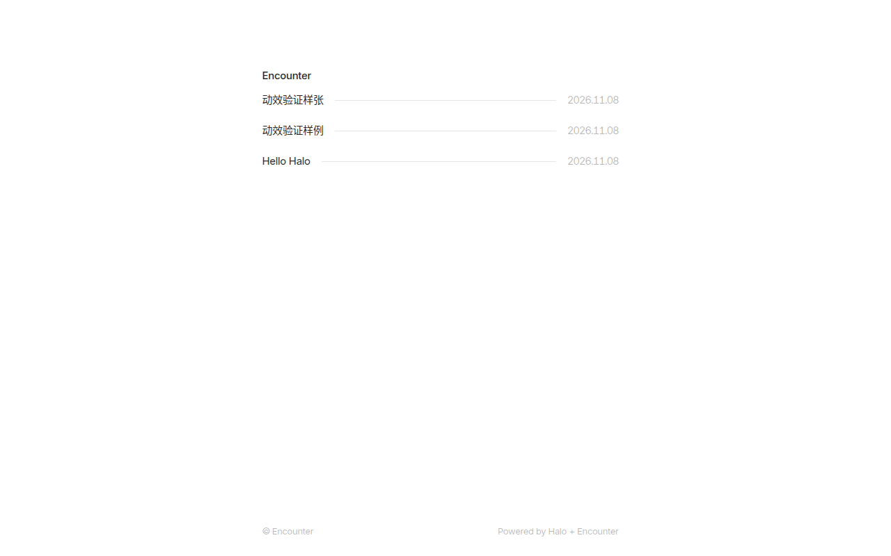
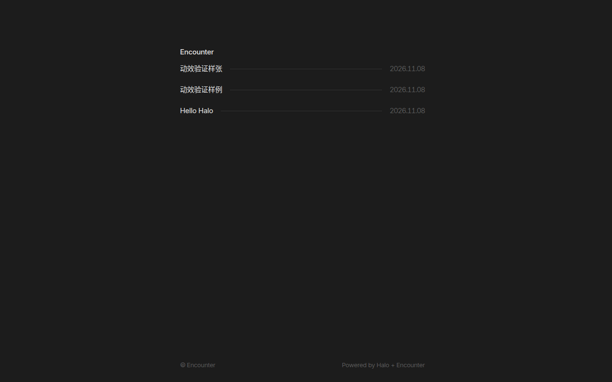
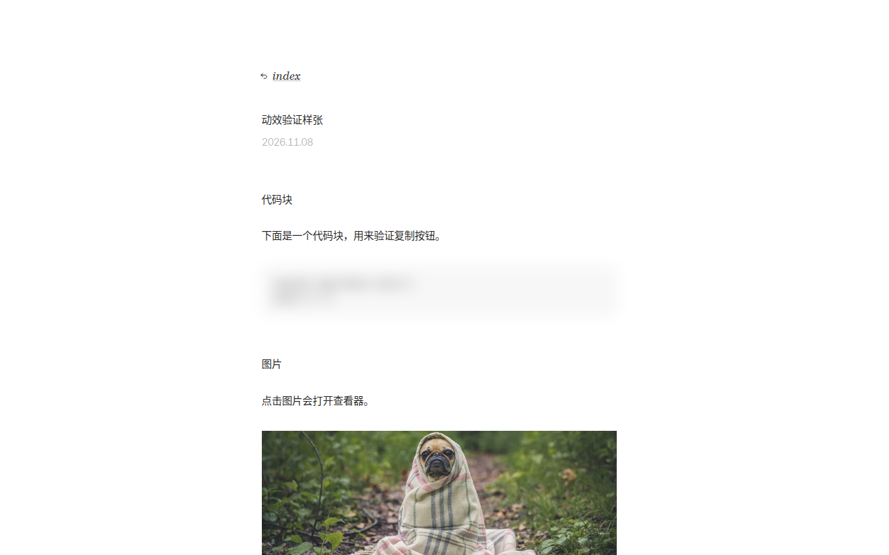
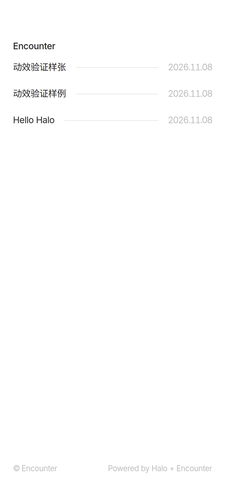
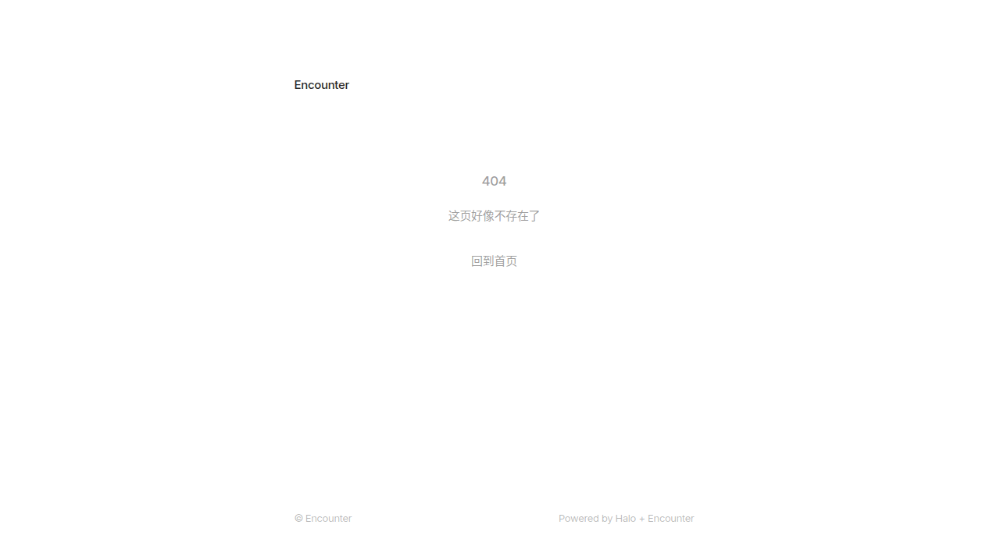

# Encounter

> 邂逅 —— 基于 [Chiri](https://github.com/the3ash/astro-chiri) 重构适配 **Halo 2.27** 的极简博客主题

一个把 Astro 静态主题完整移植到 Halo 的尝试。原则很简单：**能还原的一律按原版还原；还原不了的用最接近的能力替代；Halo 多出来的能力按原版的设计语言补进去。**

> **直接下载安装包**：[theme-encounter-0.1.0.zip](https://github.com/KeKe0904/Encounter/releases/download/v0.1.0/theme-encounter-0.1.0.zip)

当前版本 **0.1.0** · 兼容 **Halo >= 2.27.0**

---

## 预览

### 首页（浅色）



### 首页（深色）



### 文章详情（左侧为极简目录）



### 移动端



### 404



---

## 特性

- **单列窄栏排版**：内容区 560px 居中，无侧栏；顶部留白桌面 96px、移动端 64px
- **克制的标题层级**：h1/h2/h3 与正文同字号（15px / 26.25px 行高），靠字重与留白区分
- **紧凑文章列表**：44px 等高行，「标题 — 细线 — 日期」三段式，支持虚线分隔、日期左右位置
- **深色模式**：跟随系统 / 手动切换，首屏渲染前即确定主题，无闪白
- **跨文档视图转场**：旧页淡出、新页带模糊淡入（View Transition）
- **顶部滚动遮罩**：滚动超过 64px 出现渐变模糊层
- **极简目录**：正文左侧横线指示，悬停浮出标题，滚动自动高亮
- **代码复制**：悬停出现按钮，点击反馈后 1.5s 复原
- **图片查看器**：点击正文图片全屏预览，毛玻璃背景，Esc 关闭
- **KaTeX 公式**：行内 `$...$`、块级 `$$...$$` 均支持，字体全本地托管
- **评论区**：接入 Halo 评论组件，按原版版式排布，懒加载 + 骨架占位
- **归档 / 标签 / 分类 / 404 / 关于页**：用原版列表语言延伸而来

---

## 技术栈

### 运行环境

| 层 | 使用 |
| --- | --- |
| 博客系统 | **Halo 2.27.x**（Java 21 运行） |
| 主题模板 | **FreeMarker** 引擎，模板内使用 Thymeleaf 风格属性（`th:each` / `th:if` / `th:replace` / `@{...}`） |
| 布局契约 | Halo 2.26+ 的 `templates/layout.html` 页面布局契约（列表页外壳 / 文章外壳拆两个文件） |
| 静态资源 | Halo `templates/assets/`，通过 `@{/assets/...}` 解析到 `/themes/theme-encounter/assets/...` |

### 前端实现

| 能力 | 技术 |
| --- | --- |
| 样式 | 原生 CSS + **CSS 自定义属性**（语义色板 `--bg` / `--text-primary` / `--border` …），无预处理器 |
| 响应式 | 媒体查询 + `clamp` 式弹性间距，移动端隐藏目录 |
| 字体 | 自托管 `Inter` / `Besley`（woff2），中文走系统字体 |
| 交互脚本 | **原生 JavaScript**（无框架、无构建步骤），单文件 `encounter.js` |
| 页面转场 | **View Transitions API**（跨文档 `@view-transition`），非安全上下文自动降级为整页淡入 |
| 目录生成 | 扫描正文 `h2/h3` + `IntersectionObserver` 滚动高亮 |
| 评论加载 | `IntersectionObserver` 懒加载（Halo 评论组件自身机制）+ 骨架占位 + `MutationObserver` 收尾 |
| 代码复制 | `navigator.clipboard` + 自定义状态机（idle → copied → 复原） |
| 图片查看 | 懒创建遮罩层 + `backdrop-filter` 毛玻璃 + `transitionend` 清理 |
| 滚动遮罩 | `scroll` 事件 + `requestAnimationFrame` 节流 + `mask-image` 渐变 |
| 公式渲染 | **KaTeX 0.19** + `auto-render`，块级公式单独按 `displayMode` 渲染 |
| 主题记忆 | `localStorage`（`encounter-theme`），首屏前内联脚本定色避免闪烁 |

### 依赖的 Halo 插件

| 插件 | 用途 |
| --- | --- |
| PluginCommentWidget | 评论组件 |
| shiki | 代码高亮 |
| editor-hyperlink-card | 编辑器内链接卡片 |
| PluginSearchWidget | 搜索入口 |
| PluginFeed / PluginSitemap | RSS / 站点地图 |

### 开发与验收

- **Node.js 22** + **Playwright（无头 Chromium）** 做自动化验收：逐页截图、DOM 断言、动效运行时校验
- 验收清单覆盖：页面状态码、结构重复检测、转场是否运行、滚动遮罩、目录、复制按钮、图片查看器、深色模式

---

## 安装

### 方式一：下载 Release 包（推荐）

1. 打开 [Releases](https://github.com/KeKe0904/Encounter/releases) 下载 `theme-encounter-0.1.0.zip`
2. Halo 后台 → 主题 → 主题管理 → 上传安装 / 升级
3. 启用即可

> ⚠️ 不要用代码页的「Download ZIP」：那样打出来的压缩包外面会多一层 `Encounter-main/` 目录，`theme.yaml` 不在根目录，Halo 会识别失败。Release 里的包是可以直接装的。

### 方式二：目录部署

把主题目录放到 Halo 工作目录的 `themes/theme-encounter/` 下（**目录名必须与 `metadata.name` 一致**）。

---

## 主题设置

后台 → 主题 → 主题管理 → 设置：

| 分组 | 设置项 | 说明 | 默认 |
| --- | --- | --- | --- |
| 基本 | 内容区宽度 | 对应原版 `contentWidth` | `560px` |
| 基本 | 居中布局 | | 开启 |
| 基本 | 列表使用虚线分隔 | 原版 `postListDottedDivider` | 关闭 |
| 基本 | 显示页脚 | | 开启 |
| 基本 | 启用淡入动画 | 关闭后禁用转场与淡入 | 开启 |
| 日期 | 日期格式 | `YYYY-MM-DD` / `MM-DD-YYYY` / `DD-MM-YYYY` / `MONTH DAY YYYY` / `DAY MONTH YYYY` | `YYYY-MM-DD` |
| 日期 | 日期分隔符 | | `.` |
| 日期 | 日期在右侧 | 关闭则日期在标题左侧 | 开启 |
| 文章 | 显示目录 | | 开启 |
| 文章 | 显示阅读时长 | | 关闭 |
| 文章 | 图片查看器 | | 开启 |
| 文章 | 代码块复制按钮 | | 开启 |
| 文章 | 启用 KaTeX 公式 | 关闭后不加载公式资源 | 开启 |
| Halo | 启用评论 | | 开启 |
| Halo | 启用搜索入口 | | 开启 |

---

## 目录结构

```
theme-encounter/
├── theme.yaml                # 主题元信息
├── settings.yaml             # 后台设置表单
├── LICENSE                   # MIT
├── i18n/                     # 国际化（预留）
├── docs/screenshots/         # README 截图
└── templates/
    ├── layout.html           # 列表页外壳
    ├── post-layout.html      # 文章页外壳
    ├── index.html            # 首页
    ├── post.html             # 文章详情
    ├── page.html             # 独立页面
    ├── page_about.html       # 关于页（自定义模板）
    ├── archives.html         # 归档
    ├── tags.html / tag.html
    ├── categories.html / category.html
    ├── error/404.html
    ├── modules/              # head / header / footer / date / post-list / pager
    └── assets/
        ├── css/              # fonts / global / post / components / encounter / katex
        ├── js/               # encounter.js、katex、auto-render
        └── fonts/            # Inter、Besley、KaTeX 字体
```

---

## 与原版的对应关系

| 原版（Astro） | 本主题（Halo） |
| --- | --- |
| `content collections` | Halo 文章 / 独立页面 |
| `remark-math` + `rehype-katex` | KaTeX 客户端渲染 + 本地字体 |
| `rehype-copy-code` | `encounter.js` 注入复制按钮 |
| `ImageViewer` 组件 | 懒创建查看器 + 毛玻璃遮罩 |
| `TableOfContents` 组件 | 扫描 h2/h3 生成 + IntersectionObserver 高亮 |
| `TransitionWrapper` | View Transition + 非安全上下文降级淡入 |
| `GradientMask` | 滚动遮罩 |
| `config.ts` | `settings.yaml` 表单 → `theme.config` |
| 构建期生成 RSS / Sitemap | Halo 官方 Feed / Sitemap 插件 |

### 已知差异

- **LinkCard / GitHubCard / XPOST / NeoDB 卡片**：依赖原版 Markdown 指令管线，Halo 编辑器输出 HTML，暂未实现
- **OG 图动态生成**：原版用 canvaskit，Halo 侧未实现，建议用文章封面
- **图片多尺寸优化**：原版用 sharp，Halo 侧改用 `thumbnail.gen()` 缩略图
- **评论区外观**：Halo 评论组件为 shadow DOM 且未暴露 `::part`，只能通过 `--halo-cw-*` 变量调色

---

## 开发注意

1. **Halo 会缓存模板**：改 `templates/` 下的文件需重启 Halo 或重新加载主题
2. **静态资源有浏览器缓存**：改 CSS / JS 后要给引用升版本号（如 `encounter.js?v=27`），否则浏览器继续用旧文件

---

## 致谢与许可

- 原始设计与实现：[the3ash/astro-chiri](https://github.com/the3ash/astro-chiri)（MIT）
- 本项目为 Halo 2.27 移植版本，遵循 **MIT** 许可，保留原作者署名

如果这个主题对你有帮助，欢迎给原项目点个 star。